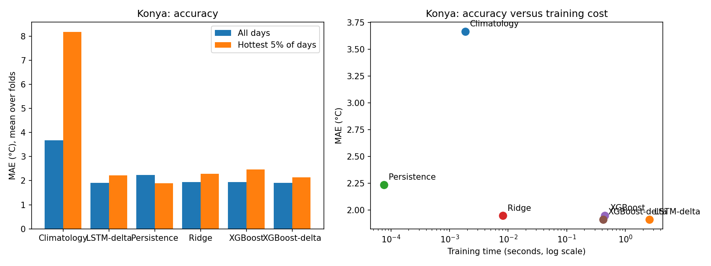

# Next-day Temperature Forecasting for Konya and Karapınar: Accuracy vs. Compute Cost

A small, reproducible study comparing simple and complex models for forecasting the **12:00 UTC 2 m temperature one day ahead** at Konya and Karapınar (Turkey), with attention to **hot days** and to **training/prediction cost**. It is the pilot for my senior thesis, which adds a wider region, more variables and a Fourier Neural Operator (FNO).

## Question
Does a more complex model buy better forecasts, and what does it cost in time and memory?

## Data
- ECMWF **ERA5** reanalysis (CDS API), 12:00 UTC, 2010-01-01 to 2024-12-31 (5,479 days).
- Variables: 10 m wind (u, v), 2 m temperature, mean sea-level pressure.
- Area 37.0–38.5°N, 31.5–33.5°E (0.25° grid, 7×9 points). Point series taken from the nearest grid cell to each town; the box average is used as extra context.
- Note: ERA5 is a reanalysis, not an operational forecast. 12:00 UTC is 15:00 local time (UTC+3), close to the afternoon peak, but the true daily maximum usually occurs around 15:00-17:00 local time, so the target is a proxy for it.

## Method
- **Target:** temperature at 12:00 UTC on day t+1. **Features (15):** today's temperature, lags 1–3, 7-day mean, wind, pressure, 1-day pressure change, box-mean wind and pressure, day-of-year sin/cos.
- **Validation:** expanding-window time series cross-validation, 5 folds, 730-day test windows, 1-day gap between train and test. Climatology, feature scaling and the hot-day threshold are fitted on training data only.
- **Hot day:** test day whose anomaly from the smoothed day-of-year climatology is at or above the 95th percentile of training anomalies.
- **Models:** Climatology, Persistence, Ridge regression, XGBoost (raw target), XGBoost-delta, LSTM-delta. The "delta" models predict the change from today's temperature.
- **Cost:** training wall time, prediction time per test window, peak RAM and peak GPU memory (`profile_call`). GPU: Colab T4.

## Results (mean ± std over 5 folds)

| Location | Model | MAE (°C) | Hot-day MAE | Hot-day bias | Train time (s) | Predict (ms) |
|---|---|---|---|---|---|---|
| Karapınar | Persistence | 2.217 ± 0.111 | 2.025 | −1.56 | ~0 | 0.01 |
| | Ridge | 1.840 ± 0.093 | 2.290 | −2.16 | 0.005 | 2.2 |
| | XGBoost | 1.876 ± 0.087 | 2.424 | −2.30 | 0.44 | 5.2 |
| | XGBoost-delta | **1.832 ± 0.092** | 2.095 | −1.88 | 0.42 | 5.1 |
| | LSTM-delta | 1.841 ± 0.081 | 2.233 | −2.03 | 1.19 | 1.2 |
| Konya | Persistence | 2.235 ± 0.124 | 1.896 | −1.40 | ~0 | 0.01 |
| | Ridge | 1.946 ± 0.118 | 2.290 | −2.15 | 0.008 | 1.8 |
| | XGBoost | 1.948 ± 0.111 | 2.457 | −2.36 | 0.45 | 5.3 |
| | XGBoost-delta | 1.912 ± 0.102 | 2.144 | −1.95 | 0.42 | 5.0 |
| | LSTM-delta | **1.911 ± 0.080** | 2.222 | −1.96 | 2.59 | 1.2 |

Climatology: MAE 3.69 (Karapınar), 3.67 (Konya). The full per-fold results are in the notebook outputs.

### Findings
1. **Every learned model beats persistence on all-days MAE** (Ridge wins 5/5 folds at both locations).
2. **Accuracy is essentially tied** among Ridge, XGBoost-delta and LSTM-delta: differences (about 0.01–0.04 °C) are far smaller than the fold-to-fold spread (about 0.1 °C). I make no claim that one is better.
3. **Predicting the change from today helped XGBoost** (MAE −0.04, hot-day bias about 0.4 °C closer to zero), but gains over Ridge are small.
4. **Heat extremes remain hard.** All learned models underpredict hot days by about 1.9–2.4 °C, and persistence has the lowest hot-day MAE.
5. **Cost differs by orders of magnitude** for the same accuracy: Ridge trains in about 5–8 ms, XGBoost in about 0.4 s, the LSTM in about 1–3 s plus about 31 MB of GPU memory.

## Limitations
- Small spatial box and few variables: models see no upstream weather, which likely limits hot-day skill.
- Hyperparameters of XGBoost and the LSTM are **not tuned**; the delta target was chosen after seeing the first XGBoost result.
- Timings come from one run on one machine. The first GPU fold includes warm-up, which inflates the LSTM mean and std.
- Reanalysis, not operational forecasts. The target is the 15:00 local-time temperature, a close proxy for, but not the same as, the daily maximum.
- 5 folds is a small sample for significance claims.

## Next steps (thesis)
- Wider region and more variables (850 hPa temperature, 500 hPa geopotential, dewpoint, soil moisture).
- Add a spatial model (FNO, and a CNN/U-Net baseline) and compare accuracy and cost under the same protocol.
- Hold out 2025–2026 as a final untouched test set; repeat timings and report mean ± std.

## Author
Nisa, Mathematics and Computer Science.
